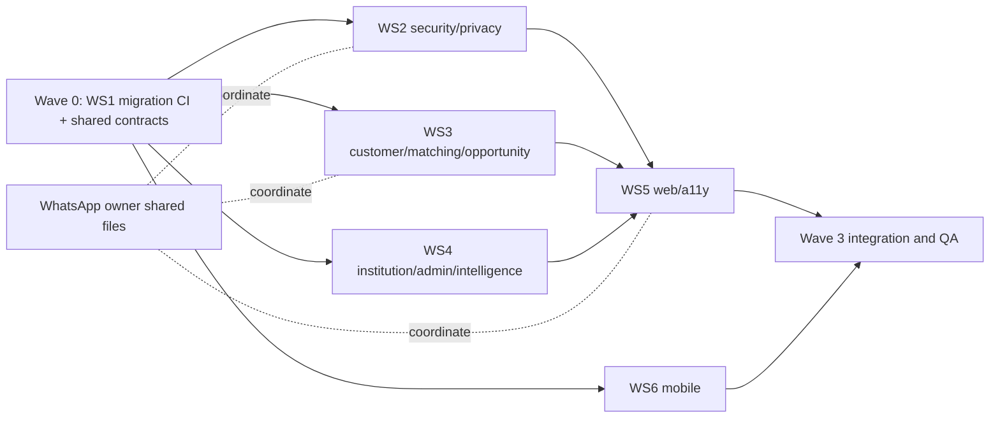

# Six-Developer Workstream Plan

Total planned backlog effort: P0/P1 = 66-104 ideal developer-days; with P2 = 85-133. Calendar estimate with six developers: 4-6 weeks for P0/P1 if one tech lead/integrator actively sequences migrations and reviews cross-cutting PRs; 6-8 weeks including P2 hardening.

## Summary

| WS | Theme | Skills | Backlog IDs | Effort range | Depends on | Blocks |
|---|---|---|---|---:|---|---|
| WS1 | Platform, CI, ops, migrations | Python/FastAPI, Alembic, CI, DevOps | B-001, B-005, B-022, B-027 | 7-13 | none | all DB/migration work |
| WS2 | Trust, identity, privacy, security controls | Python/FastAPI, security/privacy | B-002, B-003, B-004, B-018 | 15-24 | B-001 | WS3/WS4 security acceptance |
| WS3 | Customer/need/matching/opportunity | Python domain, graph/runtime tests | B-006, B-007, B-009, B-013, B-016, B-017 | 14-25 | B-001, WS2 interfaces | WS5 customer UX verification |
| WS4 | Institution/product/appetite/intelligence/commercial/admin API | Python/FastAPI, analytics | B-010, B-011, B-012, B-014, B-021, B-024 | 16-30 | B-001, WS2 controls | WS5 institution/admin UX |
| WS5 | Web frontend and accessibility | Next.js/TypeScript, QA/a11y | B-008 UI part, B-019, B-025, B-026, B-028 | 13-26 | WS1 CI, WS3/WS4 API contracts | manual QA readiness |
| WS6 | Mobile and release packaging | Flutter/Dart, Android CI | B-020 plus mobile portions of B-026/B-028 | 4-8 | WS1 CI | mobile demo readiness |

Effort balance note: WS6 is naturally smaller because V1 mobile is customer-only. Balance by assigning WS6 developer to QA automation/manual smoke support for WS5 after B-020.

## Ownership Table

| Workstream | Owns | Must not edit without coordination |
|---|---|---|
| WS1 | `.github/workflows`, `services/core-api/migrations`, `services/core-api/alembic.ini`, `render.yaml`, ops docs | Domain models without owning domain; `notification/service.py` |
| WS2 | `services/core-api/weza/platform/controls.py`, `domains/trust`, security tests, retention policy | `api/v1/public.py` COORDINATE WITH WHATSAPP OWNER; broad router rewrites |
| WS3 | `domains/customer`, `domains/need/journey.py`, `domains/matching`, `domains/opportunity`, related tests | `domains/need/service.py` COORDINATE WITH WHATSAPP OWNER; `notification/service.py` |
| WS4 | `domains/product`, `domains/appetite`, `domains/intelligence`, `domains/commercial`, `domains/integrity`, `api/v1/institution.py`, `api/v1/admin.py` | Shared model migrations without WS1; `public.py` |
| WS5 | `apps/web` except `/whatsapp-sim`, web tests/docs | `apps/web/app/page.tsx`, `apps/web/components/chat/Conversation.tsx`, `apps/web/lib/api.ts` COORDINATE WITH WHATSAPP OWNER |
| WS6 | `apps/mobile`, mobile CI/docs | API contract changes without WS3/WS4; `apps/web` |
| WhatsApp owner | `api/v1/public.py` WhatsApp sections, `domains/notification/service.py` channel adapter parts, `domains/need/service.py` outbound channel path, `services/core-api/.env.example`, `apps/web/app/page.tsx`, `apps/web/app/whatsapp-sim`, `tests/test_whatsapp_channel.py`, `scripts/replay_whatsapp_webhook.py` | WS-owned domain rules without PR review |

## Waves

- Wave 0: WS1 B-001 migration/CI protocol; WS2 confirms idempotency/rate-limit interfaces; WhatsApp owner publishes exact shared-file plan.
- Wave 1: WS2 B-003/B-004/B-018; WS3 B-006/B-007/B-009; WS4 B-010/B-012/B-014; WS6 B-020.
- Wave 2: WS1 B-005/B-022; WS3 B-013/B-016/B-017; WS4 B-011/B-021/B-024; WS5 B-019/B-025/B-026/B-028.
- Wave 3: Integration, manual QA, P0 closure, final docs.

## Alembic Protocol

- One migration owner per wave: WS1 owns revision creation/merge for Wave 0 and reviews every later migration.
- Developers may create local revisions but PRs must be rebased to a single linear `down_revision` before review.
- CI must run `alembic heads` and fail unless exactly one head exists.
- Migration PRs touching shared tables must include a data/backfill note and rollback impact.

## Merge Hotspots

- `api/v1/institution.py` and `api/v1/admin.py`: WS4 owns; other streams add small endpoints only through WS4 review.
- `platform/models.py`: WS1 owns migration-sensitive changes; domain owners propose fields.
- `domains/opportunity/service.py`: WS3 owns; WS4 coordinates for reporting/commercial changes.
- `domains/notification/service.py`: WhatsApp owner and WS3/WS5 coordinate; avoid unrelated refactors.
- `apps/web/lib/api.ts`: WS5 owns; WhatsApp owner coordinates if channel UX needs API changes.
- `requirements.txt`, `package.json`, `pubspec.yaml`: dependency changes require WS1/WS5/WS6 review respectively.

## Git Workflow

- Branches: `ws1/platform-ci/<short>`, `ws2/security/<short>`, `ws3/customer-market/<short>`, `ws4/institution-admin/<short>`, `ws5/web-a11y/<short>`, `ws6/mobile/<short>`, `wa/channel/<short>`.
- PRs: 1-3 backlog items max, migrations isolated where possible.
- Required checks: core tests, web typecheck/build for web changes, Flutter analyze/test for mobile, Alembic single-head, security scan.
- Suggested CODEOWNERS:
  - `/services/core-api/weza/platform/ @ws1 @tech-lead`
  - `/services/core-api/weza/domains/trust/ @ws2`
  - `/services/core-api/weza/domains/customer/ /need/ /matching/ /opportunity/ @ws3`
  - `/services/core-api/weza/domains/product/ /appetite/ /intelligence/ /commercial/ /integrity/ @ws4`
  - `/apps/web/ @ws5`
  - `/apps/mobile/ @ws6`
  - WhatsApp shared files require `@whatsapp-owner`.
