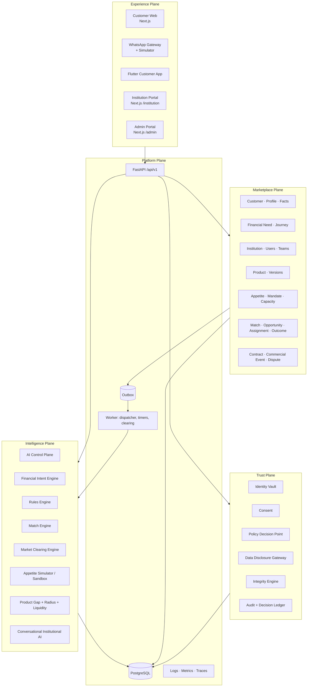

# 01 — Product Architecture Summary

## 1. What WEZA is (and is not)

WEZA is a persistent, two-sided financial marketplace. Customers bring **Financial Demand** (needs, readiness, preferences). Institutions bring **Financial Supply** (products, eligibility, appetite, capital mandates, capacity). WEZA qualifies, matches, clears, routes, tracks and learns. It creates no credit decisions, holds no funds and requires no integration with institutional systems (BRD §3.2, FSD §46–47, TSD §83–84).

```text
FINANCIAL DEMAND ──▶ WEZA INTELLIGENCE ◀── FINANCIAL APPETITE
   (customers)        Understand · Qualify ·     (institutions)
                      Match · Clear · Route ·
                      Track · Learn
```

**Zero-integration contract:** an institution goes Join → Verify → Workspace → Users → Products → Appetite → Routing → Notifications → Simulate → Activate → Receive → Contact → Report outcome. At no point does WEZA call an institution system. This is enforced architecturally: there is **no outbound connector module** in the codebase. Institution data enters only through the Institution Portal/API that WEZA owns.

## 2. Five planes → V1 modules



## 3. Deployables (TSD §82)

| Deployable | Tech | Responsibility |
|---|---|---|
| `services/core-api` | FastAPI (uvicorn) | All `/api/v1` endpoints, WhatsApp webhook, PDP, sagas started synchronously up to the outbox commit |
| `services/core-api` (worker entrypoint) | same codebase, `python -m weza.worker` | Outbox dispatcher, graph timers (`next_action_at`), service-target ageing, freshness, Waiting Room re-clearing, notification delivery/retry, digests, retention, integrity sweeps |
| `apps/web` | Next.js 15 | Customer web (`/`, `/start`, `/c/*`), Institution Portal (`/institution/*`), Admin (`/admin/*`), WhatsApp simulator (`/whatsapp-sim`) |
| `apps/mobile` | Flutter 3 | Customer app |
| `render.yaml`, `apps/web/vercel.json` | Render blueprint, Vercel config (no Azure IaC yet) | IaC |

The AI service is a **module** (`weza.intelligence.ai`) inside the monolith with a clean interface, extractable later (TSD §82 "extract only when justified").

## 4. Repository structure (TSD §88, adapted)

```text
weza/
  apps/
    web/                 # Next.js: customer, institution, admin route groups
    mobile/              # Flutter customer app
  services/
    core-api/
      weza/
        platform/        # db, outbox, events, graph runtime, idempotency, errors, logging, rate limit, config
        domains/
          identity/      # identity vault, OTP, institution users, MFA, sessions
          customer/      # customer, profile, facts (provenance), preferences, documents
          need/          # financial need, journey (conversation graph)
          institution/   # institution, workspace, teams, routing rules, notification prefs
          product/       # product + versions, eligibility rules
          appetite/      # appetite/mandate + versions, capacity
          matching/      # rules engine, match engine, market clearing, waiting room, simulator
          consent/       # consent records, templates
          opportunity/   # opportunity, assignment, outcome, freshness, interest, preview
          notification/  # policy, recipients, channels, delivery
          commercial/    # contracts, commercial events, subscriptions, disputes, attribution
          integrity/     # signals, cases
          intelligence/  # ai control plane, intent engine, insights, radius, gap, conversational AI
          trust/         # PDP, disclosure gateway, audit, decision ledger, classification, retention
          admin/         # country config, kill switches, feature flags, graph inspector
        api/v1/          # routers per domain
        worker.py
      migrations/        # alembic
      tests/             # unit, graph, integration, security, acceptance
  infrastructure/
  schemas/               # JSON Schemas for AI outputs + canonical message
  docs/
```

**Domain boundary rule [Design Recommendation]:** a domain may import another domain only through that domain's `service.py` public functions, never its models directly. This rule is checked by an import-linter contract in CI. It keeps later extraction cheap.

## 5. Three levels of engineering applied

| Level | Used for in WEZA V1 |
|---|---|
| **L1 Deterministic** | API validation, auth, RBAC/PDP, tenant isolation, eligibility rules, match scoring, clearing priority, consent, billing, every state transition, readiness, quality score, integrity rules |
| **L2 Graph** | Customer conversation journey, institution onboarding, qualified-opportunity saga, opportunity lifecycle + service targets, market clearing, waiting room, rescue, dispute, document pipeline, notification escalation |
| **L3 Agentic** | Intent extraction, next-question phrasing, profile extraction from free text, product-document rule extraction (draft only), match explanation wording, institutional conversational assistant, insight narration |

L3 never decides an L1 matter. LLM output is validated against a JSON schema. It is then treated as a *proposal* and goes to deterministic code or to human approval (TSD §9, §18).

## 6. Autonomy levels (Skill §60)

| Level | Examples in V1 |
|---|---|
| 0 Manual | Institution verification, product approval, appetite approval/activation, dispute decision, integrity case decision, kill switches, outcome reporting |
| 1 Assist | Product rule extraction, appetite-change insights, near-match/no-lead insights, product gap insights, conversational AI answers, match explanation wording |
| 2 Automate low-risk | OTP issue/verify, readiness computation, matching, ranking, routing to an institution the customer selected, assignment by configured rule, freshness ageing, reminders/escalations, billing-event creation per contract definition, duplicate holds |
| 3 Autonomous w/ guardrails | Waiting-room re-matching + customer notification (no disclosure), notification channel retry |

Every graph node in [05-graphs.md](05-graphs.md) carries an autonomy label.

## 7. Market State model (Skill §10)

`MARKET_STATE(t)` is a **read model** recomputed incrementally by the worker on every marketplace event. It is persisted in `analytics.market_state_snapshot` (hourly) and `analytics.market_state_current` (live).

| Component | Source |
|---|---|
| Customer demand | Active Financial Needs by type, amount band, sector, region, readiness |
| Product supply | ACTIVE product versions |
| Institutional appetite | ACTIVE appetite versions with capacity state |
| Capital mandates | Appetite targets (count/value) vs. fulfilled |
| Processing capacity | Capacity windows (day/week/month) used vs. limit |
| Preferences | Aggregated customer preference distribution |
| Active opportunities | Opportunities by state and freshness |
| Recent outcomes | Reported outcomes over the last 30/90 days |

The admin **Market State** screen and the institution **Demand Intelligence** screen answer the Skill §10 questions. Answers are aggregated with a privacy threshold: k ≥ 5, so any cell with fewer than 5 customers is suppressed (TSD §39).

## 8. Country configuration (TSD §71)

`CountryConfiguration` (admin-editable, versioned) holds: country code, currencies, phone regex + E.164 prefix, identity types (Uganda: NIN), administrative regions (Uganda: Central/Eastern/Northern/Western → districts), institution types (Bank, Tier II Credit Institution, MDI, SACCO, Fintech, Other), consent template IDs, retention policy, languages, regulatory feature flags. **Uganda (UG / UGX)** is seeded as the first configuration. No business logic references "UG" directly.
