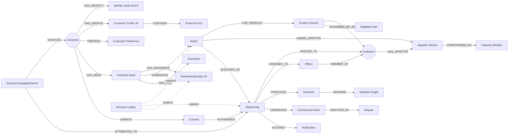

# 04 — Domain Graph, Entity Model, State Machines

## 1. Domain graph (WEZA Opportunity Graph, Skill §9)



**Storage:** PostgreSQL (Skill §9: no graph DB in V1). Edges are foreign keys or join tables. The Graph Inspector composes them with recursive queries. Temporal edges (`HAD_APPETITE` vs `HAS_APPETITE`) come from versioned tables with `effective_from` / `effective_to` (Skill §11).

## 2. Core entity model

Schemas mirror domains: `identity`, `customer`, `need`, `institution`, `product`, `appetite`, `matching`, `consent`, `opportunity`, `notification`, `commercial`, `integrity`, `trust` (audit/decision/policy), `platform` (outbox, graph, idempotency, flags), `analytics`.

All tables have `id UUID (v7)`, `created_at`, `updated_at`. Tenant-scoped tables have `institution_id NOT NULL` + index. Every query goes through a repository that injects the authenticated tenant (TSD §47). In the production profile, **Postgres Row-Level Security** policies on tenant tables act as a second barrier [Design Recommendation].

### Identity
| Table | Key fields | Class. |
|---|---|---|
| `identity.vault_record` | id (token), phone_e164 (encrypted), phone_hash (HMAC for lookup), legal_name (enc), nin (enc), email (enc), dob (enc), address (enc) | HIGHLY_SENSITIVE |
| `identity.otp_challenge` | id, phone_hash, code_hash, salt, expires_at, attempts, max_attempts, resend_count, status, channel, ip_hash | CONFIDENTIAL |
| `identity.customer_session` | id, customer_id?, channel, token_hash, expires_at, device_hash | CONFIDENTIAL |
| `identity.user` | id, email, password_hash (argon2id), mfa_secret (enc), mfa_enrolled, status, kind (INSTITUTION / WEZA) | CONFIDENTIAL |
| `identity.membership` | user_id, institution_id, roles[], team_id | INTERNAL |

### Customer & need
| Table | Key fields |
|---|---|
| `customer.customer` | id, vault_token, customer_type (SALARIED/SME/AGRICULTURE/INDIVIDUAL), country_code, verification_level (NONE/PHONE/IDENTITY), integrity_state, status, source_attribution_id |
| `customer.fact` | id, customer_id, key (e.g. `business.monthly_turnover`), value_json, source (CUSTOMER/AI_EXTRACTED/DOCUMENT/OPS), source_channel, source_ref, confidence, verification_state (SELF_REPORTED/EXTRACTED/CONFIRMED/VERIFIED/CONFLICTED), captured_at, confirmed_at, fresh_until, superseded_by |
| `customer.profile_snapshot` | id, customer_id, version, facts_json, hash, created_at (immutable) |
| `customer.preference` | customer_id, contact_channel, contact_window, ranking_prefs[] |
| `customer.document` | id, customer_id, need_id?, doc_type, storage_ref, sha256, mime, size, pipeline_state, classification, scan_result, extracted_json?, uploaded_at |
| `need.financial_need` | id, customer_id, need_type (CREDIT), product_family, amount, currency, purpose, purpose_category, urgency, sector, district, tenor_pref, status, readiness, quality_score, quality_version, waiting_until, reconfirm_at, expires_at |
| `need.conversation_message` | canonical contract: message_id, session_id, customer_id?, channel, direction, message_type, content (redacted copy), content_ref, received_at, correlation_id |

### Institution supply
| Table | Key fields |
|---|---|
| `institution.institution` | id, legal_name, display_name, type, country_code, licence_no, regulator, status, terms_version_accepted, verified_by, verified_at |
| `institution.contact` | institution_id, kind (REPRESENTATIVE/BUSINESS/COMPLIANCE), name, email, phone |
| `institution.team` | id, institution_id, name |
| `institution.routing_rule` | id, institution_id, priority, conditions_json, target_team_id?, target_user_id?, active |
| `institution.service_target` | institution_id, ack_within_minutes, first_contact_within_minutes, escalate_after_minutes |
| `institution.notification_pref` | institution_id, user_id?, event_type, channels[], min_priority, digest |
| `product.product` | id, institution_id, name, family, status, current_version_id |
| `product.product_version` | id, product_id, version, terms_json (min/max amount, tenor, pricing display), eligibility_rules_json, requirements_json, owner_id, approver_id, approved_at, effective_from, effective_to, ruleset_hash, provenance_json |
| `appetite.appetite` | id, institution_id, name, lifecycle_status, capacity_state, capacity_override, current_version_id |
| `appetite.appetite_version` | id, appetite_id, version, product_ids[], criteria_json, min_match_score, target_count, target_value, capacity_limits_json, campaign_from/to, approved_by, simulation_run_id, effective_from/to |
| `appetite.capacity_usage` | appetite_id, window (DAY/WEEK/MONTH), window_start, count_used, value_used |

### Matching & market
| Table | Key fields |
|---|---|
| `matching.match` | id, need_id, institution_id, product_version_id, appetite_version_id, state (CANDIDATE/ELIGIBLE/EXCLUDED/RANKED/PRESENTED/SELECTED/INVALIDATED/EXPIRED), eligibility_result_json, components_json {product_fit, appetite_fit, preference_fit, readiness, capacity_fit}, score, rank, algorithm_version, weights_version, ruleset_hash, profile_snapshot_id, explanation_json, invalidated_reason, expires_at |
| `matching.clearing_run` | id, trigger_event, scope, started_at, finished_at, needs_evaluated, matches_created, invalidated, algorithm_version, shadow_algorithm_version? |
| `matching.simulation_run` | id, institution_id, appetite_version_id?, criteria_json, result_json, synthetic(bool), created_by |
| `matching.waiting_entry` | need_id, opted_in_at, expires_at, last_cleared_at, reconfirm_due_at, status |
| `matching.weights_config` | version, weights_json, active, created_by |

### Trust
| Table | Key fields |
|---|---|
| `consent.consent_template` | id, country_code, purpose, version, language, text, text_hash, effective_from (immutable once published) |
| `consent.consent` | id, customer_id, institution_id, opportunity_id?, match_id, purpose, data_categories[], template_id, text_hash, status (GRANTED/WITHDRAWN/EXPIRED), granted_at, withdrawn_at, channel, contact_pref |
| `trust.audit_event` | id, actor_type, actor_id, institution_id?, action, object_type, object_id, before_json?, after_json?, reason?, versions_json, correlation_id, ip_hash, at — append-only (DB trigger blocks UPDATE/DELETE) |
| `trust.decision` | id, decision_type, subject_type, subject_id, input_ref/snapshot, ruleset_version, algorithm_version, model_version?, output_json, explanation_json, at |
| `trust.policy_decision_log` | id, actor, tenant, resource, purpose, result (PERMIT/DENY/PERMIT_WITH_RESTRICTED_FIELDS), fields_permitted[], policy_version, at |
| `trust.data_classification` | entity, field, class |

### Opportunity
| Table | Key fields |
|---|---|
| `opportunity.opportunity` | id, reference (OPP-XXXXX), need_id, customer_id, institution_id, match_id, consent_id, state, freshness, snapshot_json (frozen: profile snapshot id, product/appetite versions, scores, explanation, consent, attribution), routing_strategy, idempotency_key UNIQUE, qualified_at, routed_at, received_at |
| `opportunity.assignment` | opportunity_id, team_id?, user_id?, assigned_at, assigned_by (RULE/USER), ack_due_at, first_contact_due_at, first_contact_at, next_action_due_at, breach_state |
| `opportunity.outcome` | id, opportunity_id, state, reason_category, reason_note, approved_amount, disbursed_amount, disbursed_on, reported_by, reported_at, idempotency_key |
| `opportunity.preview` | id, need_id, institution_id, payload_json (allow-listed), interest_state, expires_at |
| `opportunity.activity` | opportunity_id, kind, actor, note, at |

### Commercial & integrity & platform
| Table | Key fields |
|---|---|
| `commercial.attribution` | id, source, campaign_id, partner_id, referral_code, landing_url, first_seen_at |
| `commercial.campaign` / `partner` | id, name, owner, institution_id?, active |
| `commercial.contract` | id, institution_id, plan, billing_cycle, included_opportunities, opportunity_price, currency, qualified_definition_json, duplicate_window_days, dispute_window_days, effective_from/to |
| `commercial.commercial_event` | id, opportunity_id, institution_id, contract_id, kind (QUALIFIED_OPPORTUNITY/CREDIT/REVERSAL/SUBSCRIPTION), amount, status (PENDING/BILLABLE/INCLUDED_IN_PLAN/DISPUTED/REVERSED/CREDITED), idempotency_key UNIQUE, reverses_event_id? |
| `commercial.dispute` | id, commercial_event_id, reason, evidence_json, state, decision, decided_by, decision_note |
| `integrity.signal` / `integrity.case` | signal kind, subject, score, rule; case state (OPEN/REVIEW/DECIDED), result (ALLOW/REVIEW/BLOCK) |
| `notification.notification` | id, event_id, recipient_type/id, channel, priority, template, payload_json, status (QUEUED/SENT/DELIVERED/FAILED/ACKED), attempts, ack_required, ack_at, escalated |
| `platform.outbox` | id, topic, event_type, aggregate_type/id, payload_json, correlation_id, created_at, published_at?, attempts, last_error, dead_lettered |
| `platform.inbox` (consumer dedupe) | consumer, event_id (PK pair) |
| `platform.idempotency_key` | key, scope, request_hash, response_json, created_at |
| `platform.graph_instance` / `graph_transition` | see [08-runtime-events.md](08-runtime-events.md) |
| `platform.feature_flag`, `platform.kill_switch`, `admin.country_config`, `admin.question_path` | versioned config |

## 3. State machines (server-enforced; each transition = audit + outbox event)

```text
FINANCIAL NEED / JOURNEY  (resolves C1)
DRAFT → INTENT_CAPTURE → PHONE_VERIFICATION → PROFILE_IN_PROGRESS → READY_FOR_MATCHING
  → MATCHED → CUSTOMER_SELECTED → CONSENTED → SUBMITTED (Opportunity created) → TRACKING
  side: ALMOST_READY ⇄ PROFILE_IN_PROGRESS · NO_CURRENT_MATCH → WAITING → READY_FOR_MATCHING
        any → PAUSED_BY_CUSTOMER → (resume) · any → EXPIRED · any → CLOSED (customer)

OPPORTUNITY  (FSD §44.1 from QUALIFIED)
QUALIFIED → ROUTED → RECEIVED → ASSIGNED → CONTACTED → PROCEEDING → SUBMITTED_TO_INSTITUTION
  → REPORTED_APPROVED → REPORTED_DISBURSED → CLOSED
  → REPORTED_DECLINED → REMATCH_ELIGIBLE (customer confirms) | CLOSED
  ASSIGNED…SUBMITTED → WITHDRAWN (customer) → CLOSED
  QUALIFIED → ROUTING_FAILED → (compensate) CLOSED + need back to READY_FOR_MATCHING
  Officer may skip forward (e.g. RECEIVED → CONTACTED auto-assigns) but never backward.

FRESHNESS  FRESH → ATTENTION_REQUIRED → STALE → EXPIRED  (timer-driven; reset by activity)

MATCH  CANDIDATE → ELIGIBLE | EXCLUDED;  ELIGIBLE → RANKED → PRESENTED → SELECTED
       any non-final → INVALIDATED | EXPIRED

INSTITUTION  DRAFT → SUBMITTED → UNDER_VERIFICATION → APPROVED → CONFIGURING → READY → ACTIVE
             ACTIVE ⇄ PAUSED;  any → SUSPENDED (WEZA) → ACTIVE | CLOSED;  REJECTED (from UNDER_VERIFICATION)

PRODUCT  DRAFT → PENDING_APPROVAL → ACTIVE ⇄ PAUSED → ARCHIVED;  PENDING_APPROVAL → DRAFT (rejected)

APPETITE lifecycle  DRAFT → SIMULATED → APPROVED → ACTIVE ⇄ PAUSED → EXPIRED | ARCHIVED
APPETITE capacity   ACTIVE ⇄ LIMITED ⇄ FULL;  PAUSED (manual)   (resolves C2)

CONSENT  GRANTED → WITHDRAWN | EXPIRED
DOCUMENT UPLOADED → QUARANTINED → SCANNED → VALIDATED → STORED → CLASSIFIED → (EXTRACTED) → CONFIRMED | REJECTED
DISPUTE  OPEN → UNDER_REVIEW ⇄ FURTHER_INVESTIGATION → DECIDED{CHARGE_VALID|CHARGE_REVERSED|OPPORTUNITY_REPLACED} → CLOSED (resolves C3)
COMMERCIAL EVENT  PENDING → BILLABLE | INCLUDED_IN_PLAN → DISPUTED → (REVERSED via reversal event) 
INTEGRITY  NORMAL → REVIEW → HIGH_RISK → BLOCKED (and back on human decision)
WAITING  OPTED_IN → MATCH_FOUND → (customer review) | RECONFIRM_DUE → OPTED_IN | EXPIRED
NOTIFICATION  QUEUED → SENT → DELIVERED → ACKED;  → FAILED → retry → DEAD_LETTERED;  unacked → ESCALATED
```

Each machine is a declarative table `{from, event, to, guard, permission}` in code. One `transition()` function per aggregate validates, writes audit + outbox atomically and rejects any other path with `INVALID_TRANSITION` (HTTP 409).

## 4. Scoring definitions (kept separate — Skill §14)

| Concept | Definition V1 | Version key |
|---|---|---|
| **Eligibility** | Per product-version rule: PASS / FAIL / UNKNOWN with required vs observed value and reason code. Eligible = no FAIL. UNKNOWN on a *required* fact → ALMOST_READY. | `ruleset_hash` |
| **Readiness** | READY_NOW if intent confirmed + phone verified + mandatory profile facts for the customer type present + ≥ 1 eligible match with no UNKNOWN. ALMOST_READY if ≥ 1 match fails only on UNKNOWN/missing documents. Else NO_CURRENT_MATCH. | `readiness_v1` |
| **Quality Score (0–100)** | Weighted: phone verified 20, identity captured 15, mandatory profile completeness 30, document completeness 15, consistency (no conflicts) 10, responsiveness 10. *Not* creditworthiness. | `quality_v1` |
| **Match Score (0–100)** | `100 × Σ wᵢ·componentᵢ` with components: product_fit (share of soft criteria satisfied + amount position in range), appetite_fit (criteria match within appetite incl. sector/region/ticket/age), preference_fit, readiness (1/0.6/0), capacity_fit (1 ACTIVE, 0.6 LIMITED, 0 FULL). Default weights 0.30/0.30/0.10/0.15/0.15 in `weights_config` v1. Must be ≥ appetite `min_match_score`. | `match_v1` + weights version |
| **Ranking** | Order by score desc, then customer preference tie-breakers, then deterministic id. Sponsored slots (off in V1) are never mixed in. | `rank_v1` |
| **Clearing priority** | readiness desc, waiting time desc, match score desc, need freshness, created_at — deterministic, logged in Decision Ledger. | `clearing_v1` |
