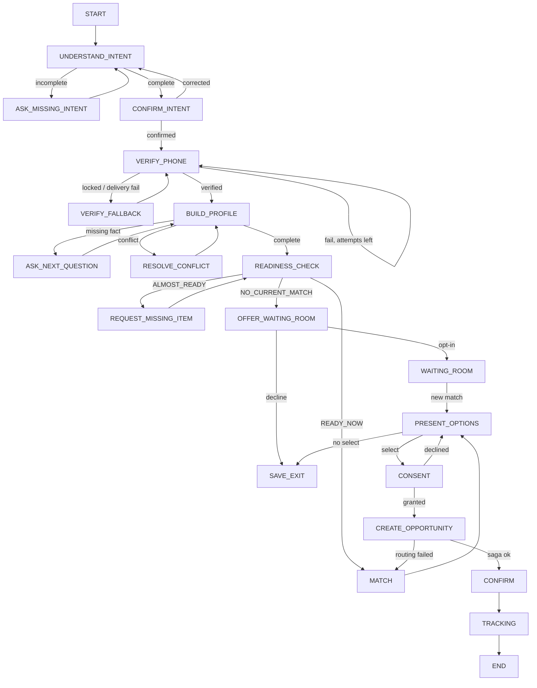
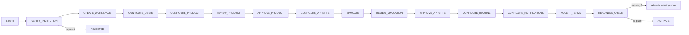
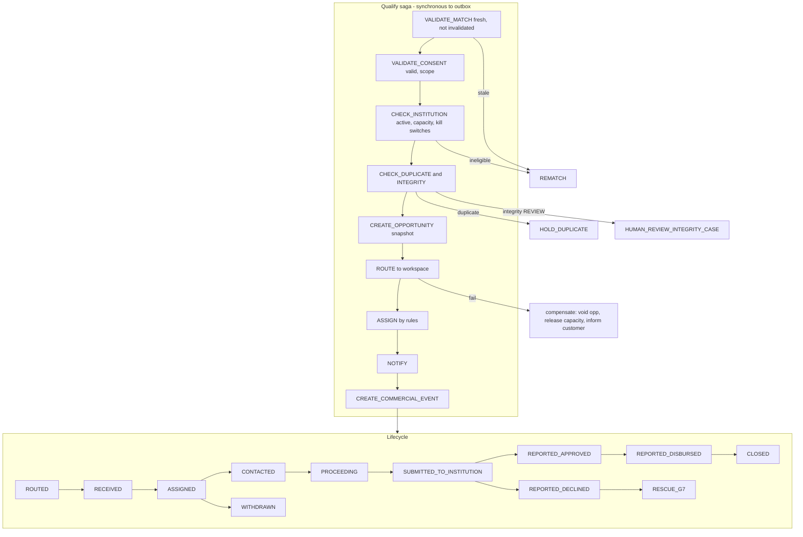
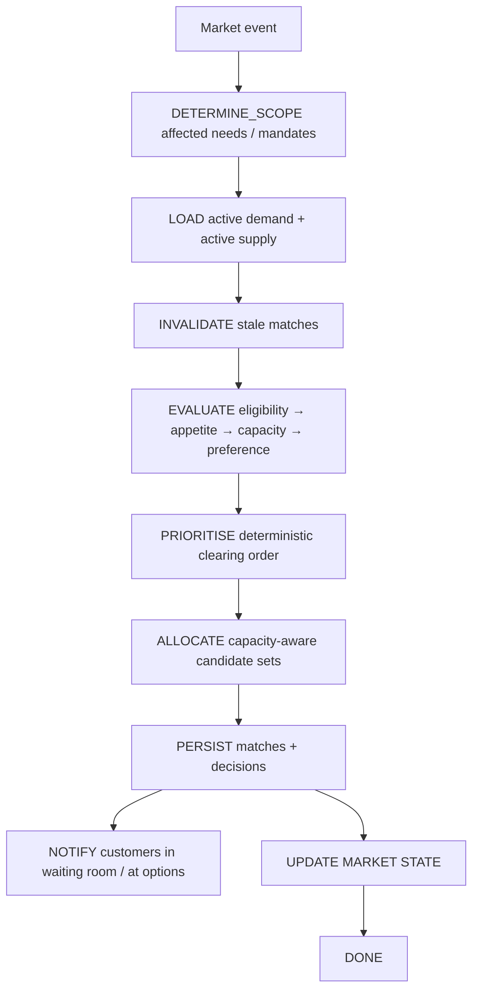

# 05 — Workflow Graphs (Skill §69 specification for each)

All graphs run on the WEZA graph runtime ([08-runtime-events.md](08-runtime-events.md) §1). Each graph's state lives in `platform.graph_instance`, never in chat history or LLM memory. Every node has an **autonomy level (AL0–AL3)**, and every waiting node has a timeout.

---

## G1 — Customer Conversation Graph (`customer_journey` v1)



| Spec | Detail |
|---|---|
| **Trigger** | `SessionStarted` (web/app/WhatsApp canonical message without active journey) or `ResumeRequested` |
| **State** | `{need_id, customer_id?, session_id, channel, intent{field:{value,confidence,confirmed}}, pending_question_key, asked_keys[], otp_challenge_id?, readiness, match_ids[], selected_match_id?, consent_id?, opportunity_id?, ai_mode, loop_counters{intent, profile, missing_item}}` |
| **Nodes / autonomy** | UNDERSTAND_INTENT (AL1: AI extract → schema validate), ASK_MISSING_INTENT (AL2), CONFIRM_INTENT (interrupt: customer), VERIFY_PHONE (interrupt: OTP, AL2), BUILD_PROFILE / ASK_NEXT_QUESTION (AL2, question path config; AI may phrase), RESOLVE_CONFLICT (interrupt: customer, else human), READINESS_CHECK (AL2 deterministic), MATCH (AL2), PRESENT_OPTIONS (interrupt: customer), CONSENT (interrupt: customer, AL0 decision), CREATE_OPPORTUNITY (AL2 saga), WAITING_ROOM (AL3 re-matching, no disclosure) |
| **Edges / conditions** | Intent complete = amount + purpose + customer_type present and every *critical* field confidence ≥ 0.85 or confirmed. Profile complete = all mandatory keys from question path(customer_type, product_family) have non-stale facts. |
| **Tools** | `extract_financial_intent`, `extract_profile_facts`, `phrase_next_question` (AI CP); `otp.issue/verify`; `profile.upsert_fact`; `readiness.evaluate`; `matching.match_need`; `consent.grant`; `opportunity.qualify_saga` |
| **Events emitted** | `NeedCreated`, `IntentConfirmed`, `PhoneVerified`, `FactRecorded`, `FactConflictDetected`, `ReadinessEvaluated`, `NeedMatched`, `MatchSelected`, `ConsentGranted/Declined`, `WaitingRoomOptIn`, `JourneyPaused/Expired` |
| **Events consumed** | `MatchesInvalidated` (→ re-MATCH if at PRESENT_OPTIONS), `WaitingRoomMatchFound`, `OpportunityRoutingFailed` |
| **Human interrupts** | RESOLVE_CONFLICT escalates to Human Control Centre after 2 unresolved customer attempts; AI schema failure ×2 → structured fallback (not human) |
| **Retry** | AI call: 1 retry with repair prompt, then deterministic fallback. OTP: per FSD-IDV-001. |
| **Timeouts** | Customer inactivity: reminder at 24 h and 72 h (max 2) → `PAUSED_BY_CUSTOMER`; expire at 14 days. OTP challenge 5 min. Consent screen: match validity 24 h (re-validate on resume). |
| **Stop conditions** | END (tracking handed to G3) · EXPIRED · customer CLOSE · integrity BLOCKED · loop budget: intent ≤ 6 turns, profile ≤ 25 questions, missing-item ≤ 3 cycles → human-assisted/save-exit |
| **Persisted** | graph_instance + transitions; canonical messages (redacted); facts; snapshots |
| **Audit** | intent confirmed, phone verified, consent granted/declined, opportunity created |
| **Failure / compensation** | Saga failure → no disclosure, need back to READY_FOR_MATCHING, customer informed (FSD-OPP-005) |
| **Idempotency** | Inbound message_id dedupe (`platform.inbox`); consent grant keyed by (match_id, template_version); saga keyed by `need_id:match_id` |
| **Metrics** | node entry/exit, drop-off per node, turns to intent, AI fallback rate, OTP success, time-to-ready, consent rate |
| **Trace** | BRD §6–9; FSD §4–14; TSD §5–15; FR-001…012 |

---

## G2 — Institution Onboarding Graph (`institution_onboarding` v1)



| Spec | Detail |
|---|---|
| **Trigger** | `InstitutionApplicationSubmitted` |
| **State** | `{institution_id, checklist{verified, users, product_approved, appetite_approved, routing, notifications, terms, sandbox_run}, last_missing[], reviewer_ids}` |
| **Nodes / autonomy** | VERIFY_INSTITUTION = **HUMAN (WEZA Ops), AL0**; APPROVE_PRODUCT = `HUMAN_APPROVE_PRODUCT_CONFIGURATION` AL0 (maker-checker); APPROVE_APPETITE = `HUMAN_APPROVE_APPETITE_CHANGE` AL0; SIMULATE AL2; READINESS_CHECK AL2; ACTIVATE AL0 (inst. admin click) |
| **Conditions** | Readiness = FSD §21 table, evaluated deterministically. Missing items listed in order. |
| **Tools** | institution.verify, users.invite, product.*, appetite.*, simulator.run, routing.save, notif.save |
| **Events** | `InstitutionVerified/Rejected`, `WorkspaceProvisioned`, `ProductApproved`, `AppetiteApproved`, `InstitutionActivated` (consumed by Market Clearing) |
| **Timeouts** | Verification SLA 3 business days → Ops escalation; inactive configuration 14 days → reminder to inst. admin; 60 days → `DORMANT` flag (no deletion) |
| **Stop** | ACTIVATE · REJECTED · CLOSED |
| **Compensation** | Activation failure (e.g. appetite expired in the meantime) → back to CONFIGURE_APPETITE |
| **Idempotency** | Activate keyed by institution_id + config hash |
| **Metrics** | time per node, time-to-activate, readiness failures by item |
| **Trace** | BRD §10–14; FSD §16–21; FR-013…019 |

---

## G3 — Qualified Opportunity Saga + Lifecycle (`opportunity_lifecycle` v1)



| Spec | Detail |
|---|---|
| **Trigger** | `ConsentGranted` (from G1) |
| **State** | `{opportunity_id, need_id, match_id, consent_id, institution_id, step, compensations_done[], assignment, service_target_due{ack, first_contact}, freshness}` |
| **Autonomy** | Saga steps AL2; assignment AL2 (rules) / AL0 manual; outcome reporting AL0 (institution); integrity hold → `HUMAN_REVIEW_INTEGRITY_CASE` |
| **Conditions** | Steps 1–5 + capacity reservation run in **one DB transaction** with outbox events; steps 7–9 are idempotent consumers of `OpportunityQualified` |
| **Events** | `OpportunityQualified`, `OpportunityRouted`, `OpportunityReceived` (first institution view), `OpportunityAssigned`, `ServiceTargetApproaching/Breached`, `OpportunityContacted`, `OutcomeReported`, `OpportunityWithdrawn`, `OpportunityClosed`, `FreshnessChanged` |
| **Human interrupts** | Officer actions; duplicate hold resolution by WEZA Ops; integrity review |
| **Retry** | Consumers: exponential backoff 5 attempts (1 s → 5 min) → dead letter + alert (routing, notification, billing critical) |
| **Timeouts** | ack target (default 2 h business), first contact (default 24 h) → approaching at 75 % → officer; breach → officer + manager; 2× breach → WEZA Ops + customer informed of next steps (BRD §33). Freshness: FRESH < 3 d of no activity, ATTENTION_REQUIRED 3–7 d, STALE 7–21 d (customer reconfirmation asked), EXPIRED > 21 d (closed, no further billing) — configurable per country. |
| **Stop** | CLOSED / EXPIRED / WITHDRAWN-closed |
| **Compensation** | Routing failure → opportunity `ROUTING_FAILED`, capacity released, commercial event not created/reversed, need → READY_FOR_MATCHING, customer told "re-checking options" |
| **Idempotency** | `opportunity.idempotency_key = need_id:match_id`; commercial event key `opp_id:QUALIFIED_OPPORTUNITY`; outcome key per report; inbox dedupe for consumers. *Repeated `OpportunityQualified` ⇒ one opportunity, one delivery, one billable event (TSD §56).* |
| **Metrics** | saga latency, failure per step, routing success, time to first contact, breach rate, stage conversion |
| **Trace** | FSD §14–15, §25–27, §37; TSD §30–33, §55–57, §60; FR-011, 012, 023–025, 033 |

---

## G4 — Market Clearing Graph (`market_clearing` v1)



| Spec | Detail |
|---|---|
| **Triggers** | `NeedReadyForMatching`, `ProductActivated/Paused/Archived`, `AppetiteActivated/Changed/Paused`, `CapacityChanged`, `InstitutionActivated/Paused/Suspended`, `CustomerReactivated`, `OpportunityExpired`, `FactChanged(material)`, hourly sweep |
| **State** | clearing_run row: trigger, scope, counts, algorithm version |
| **Autonomy** | AL2 deterministic. **No LLM allocates the market** (Skill §22). |
| **Rules** | Capacity-aware: when an appetite is LIMITED, only top-priority needs (clearing order) are offered it until the window budget is used. FULL → excluded. Identity disclosure is never triggered by a match (TSD §22). |
| **Shadow mode** | Optional `shadow_algorithm_version` computes matches into `matching.shadow_match` only; compared in admin; never shown to customers (Skill §56) |
| **Retry / timeout** | Run is idempotent per (trigger_event_id, scope); max runtime 60 s → split scope |
| **Stop** | scope exhausted |
| **Metrics** | run latency, needs evaluated, new matches, invalidations, unmatched demand, liquidity by segment |
| **Trace** | FSD-MAT-001…004, §29; TSD §20–24; FR-007, 008, 027 |

---

## G5 — Customer Waiting Room Graph (`waiting_room` v1)

```text
NO_CURRENT_MATCH → OFFER → OPT_IN (expires_at = +30d) → WAIT
WAIT —(market event in scope / daily sweep)→ RE_MATCH → found? 
   NO → WAIT
   YES → NOTIFY_CUSTOMER (WhatsApp/SMS/in-app, no institution identity disclosure needed beyond name of option) → AWAIT_REVIEW (7d) → G1.PRESENT_OPTIONS
WAIT —(day 25)→ RECONFIRM_DUE → customer confirms → WAIT (+30d, max 3 renewals) | no reply 5d → EXPIRED
```
Autonomy AL3 for re-match + notify (non-consequential; consent still required to route). Metrics: wait-to-match time, waiting → opportunity conversion, expiry rate. Trace: FSD-WAIT-001, TSD §23, FR-027.

---

## G6 — Institution Capital Deployment Graph (`capital_deployment` v1)

```text
MANDATE ACTIVE → (continuous) RECEIVE OPPORTUNITIES → OUTCOMES REPORTED
→ weekly ANALYSE_PERFORMANCE (fill rate vs target, conversion, decline reasons, near-miss demand)
→ GENERATE_INSIGHT (deterministic thresholds; AI narrates)
→ HUMAN_APPROVE_APPETITE_CHANGE? (credit/risk lead reviews)
   dismiss → record reason
   simulate → SIMULATE → approve → NEW APPETITE VERSION (DRAFT→…→ACTIVE) → AppetiteChanged → G4
MANDATE target reached → capacity FULL → notify business lead; campaign end → EXPIRED
```
WEZA never changes appetite autonomously (BR-004). Insight thresholds: ≥ 10 reported declines in 30 days with one reason ≥ 40 % on a criterion WEZA already enforces; fill rate < 25 % at mid-campaign with near-miss demand ≥ 2× target. Trace: FSD §35, BRD §27, FR-031.

---

## G7 — Opportunity Rescue Graph (`opportunity_rescue` v1)

```text
OutcomeReported(REPORTED_DECLINED) → NEED_STILL_ACTIVE? (ask customer)
   no / 7d no reply → CLOSE need
   yes → WANTS_ALTERNATIVES? → yes → RE_MATCH (excluding declining institution; previous institution data NOT reused beyond scope — new consent)
        → alternatives? no → OFFER_WAITING_ROOM (G5)
                        yes → PRESENT_OPTIONS → select → NEW CONSENT → NEW OPPORTUNITY (G3)
```
Never automatically routes elsewhere (Skill §35, BR-006). Autonomy AL2 for re-match, AL0 customer decisions. Trace: FSD §36, BRD §28, FR-032.

---

## Supporting graphs (smaller)

| Graph | Nodes | Human node | Timeout |
|---|---|---|---|
| `document_pipeline` | UPLOAD→QUARANTINE→SCAN→VALIDATE→STORE→CLASSIFY→(EXTRACT)→CONFIRM | low-confidence extraction → customer confirm | scan 5 min → retry ×3 → REJECTED + ops alert |
| `dispute` | OPEN→UNDER_REVIEW⇄FURTHER_INVESTIGATION→DECIDED→CLOSED | `AUTHORISED_COMMERCIAL_REVIEW` | review SLA 10 business days → escalate |
| `integrity_case` | SIGNALS→SCORE→ALLOW/REVIEW/BLOCK→(HUMAN_REVIEW_INTEGRITY_CASE)→OUTCOME | yes | 48 h review SLA; held opportunities never auto-released |
| `notification_escalation` | see L5 | — | ack windows |
| `product_extraction` | UPLOAD→SCAN→EXTRACT (AI)→VALIDATE schema→DRAFT→`HUMAN_APPROVE_PRODUCT_CONFIGURATION` | yes | none (draft persists) |
