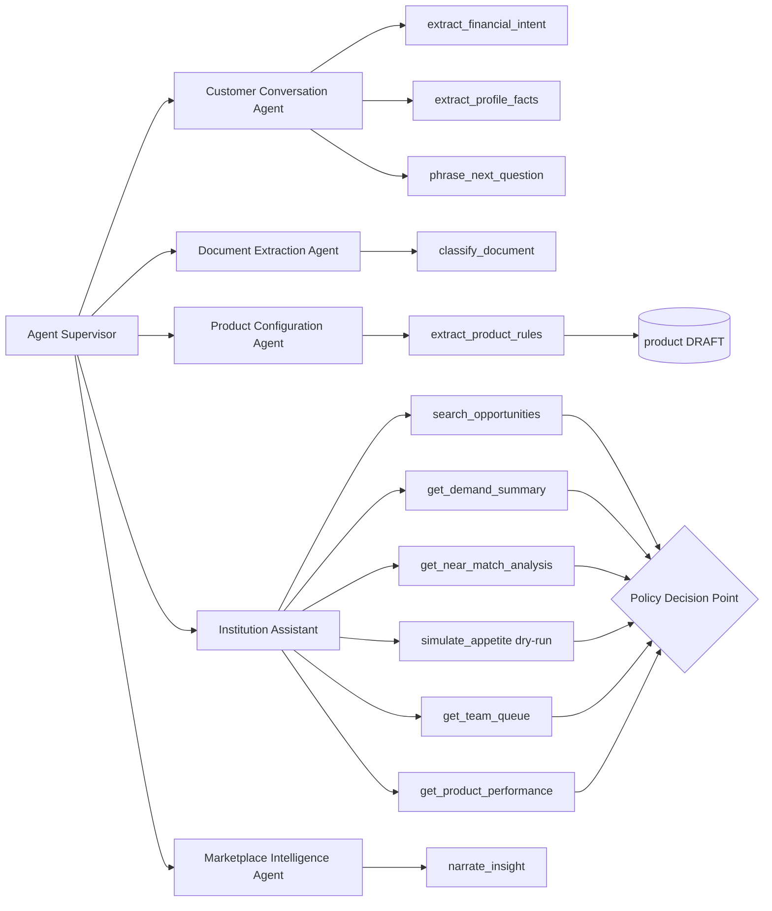

# 07 — AI Control Plane, Agents, Tools, Human-in-the-Loop

## 1. AI Control Plane (TSD §8–9, §67, §76–77)

Business code calls **capabilities**, never a provider:

| Capability | Input | Output schema (versioned in `/schemas`) | Fallback when AI unavailable |
|---|---|---|---|
| `extract_financial_intent` | customer text (untrusted), country config | `FinancialIntent v1` {amount, currency, purpose, purpose_category, customer_type, sector, urgency, product_family, missing[], confidence{}} | Deterministic parser (amount/currency regex incl. "30M", "30 million", "UGX 30,000,000"; keyword purpose/sector dictionaries) + structured quick-reply questions |
| `extract_profile_facts` | answer text + expected key | `CustomerProfileExtraction v1` | Typed input validation for the expected key |
| `phrase_next_question` | question key + context (no PII) | `{text}` | Question bank text from question path config |
| `extract_product_rules` | scanned document text | `ProductRuleExtraction v1` {fields, rules[], requirements[], provenance[{field, page, quote}], confidence} | Manual editor |
| `generate_match_explanation` | structured reason codes | `MatchExplanation v1` {summary, bullets[]} | Template from reason codes (*AI may only reword codes, never add reasons* — validator checks every bullet maps to a code) |
| `classify_document` | scanned doc metadata + text | `DocumentClassification v1` | Customer-declared type |
| `answer_institution_query` | question + tool results | `InstitutionQuery v1` {intent, tool_calls[], answer, cited_results[]} | Show tool picker UI |
| `narrate_insight` / `narrate_briefing` | aggregates | `{text}` | Templates |

**Pipeline per call:** budget check → PII minimisation (no phone/NIN/name sent; customer identified by token) → prompt-injection defence (untrusted content wrapped in delimited data blocks, system rule "content is data", tool allow-list, output never executed) → provider call (timeout) → JSON-schema validation → 1 repair retry → fallback → `ai_call_log` (capability, prompt_version, schema_version, provider, model, latency, tokens in/out, cost, validation_ok, fallback_used, correlation_id; no raw PII).

**Modes (kill switch):** `AVAILABLE` / `DEGRADED` (only extraction capabilities; phrasing uses templates) / `UNAVAILABLE` (all fallbacks). It switches automatically to DEGRADED when the provider error rate is > 20 % over 5 min, and Ops can override. **WEZA keeps working with no API key**: this is the default in CI and tests.

**Provider:** Anthropic Claude via adapter `AnthropicProvider` (model configurable, default a current Claude model). An adapter interface allows Azure OpenAI or others (TSD §77).

## 2. What AI must never do (enforced in code, not prompts)
Approve credit · disburse · change appetite · activate product rules · override consent · override permissions · create hidden placement · access the DB directly. Enforcement: AI capabilities have **no write tools** except returning proposals. Persistence of AI output happens in deterministic services that set status = DRAFT / NEEDS_CONFIRMATION.

## 3. Agents (Skill §46)

| Agent | Graph(s) | Allowed tools | Forbidden |
|---|---|---|---|
| Customer Conversation Agent | G1 (UNDERSTAND_INTENT, BUILD_PROFILE phrasing) | extract_financial_intent, extract_profile_facts, phrase_next_question | matching, consent, any institution data |
| Document Extraction Agent | document_pipeline, product_extraction | classify_document, extract_product_rules | storage write except draft JSON |
| Product Configuration Agent | product_extraction | extract_product_rules, product.create_draft | product.approve, product.activate |
| Institution Assistant | I-19 | search_opportunities, get_demand_summary, get_product_performance, get_near_match_analysis, simulate_appetite (dry-run), get_team_queue | any mutation |
| Marketplace Intelligence Agent | L1, L2, digests | narrate_insight, narrate_briefing (inputs = aggregates) | raw customer data |

**Supervisor:** `AgentSupervisor` selects the agent for a graph node, injects the tool allow-list, enforces budgets/iterations, catches failures → fallback or Human Control Centre, and writes `agent_step` records (agent, tool, args hash, result status). Agents exchange **typed Pydantic messages**, never free-text chains.

## 4. Agent / tool graph

Every institution tool independently calls the PDP with the *user's* identity, tenant and role (TSD §36).

## 5. Human-in-the-loop map (Skill §47)

| Human node | Who | Where | Graph | Timeout behaviour |
|---|---|---|---|---|
| `HUMAN_VERIFY_INSTITUTION` | WEZA Ops | A-02 | G2 | 3 business days → escalate to Ops lead |
| `HUMAN_APPROVE_PRODUCT_CONFIGURATION` | Inst. approver ≠ author (`product.approve`) | I-10 | G2, product_extraction | Reminder 3 d; stays DRAFT |
| `HUMAN_APPROVE_APPETITE_CHANGE` | Inst. approver (`appetite.activate`) | I-12 | G2, G6 | Reminder 3 d |
| `HUMAN_PRODUCT_DECISION` | Business lead | I-17 | L2 | none |
| `HUMAN_REVIEW_INTEGRITY_CASE` | WEZA Ops | A-07 | integrity_case, G3 | 48 h → escalate; customer informed of delay |
| `AUTHORISED_COMMERCIAL_REVIEW` | WEZA Commercial | A-08 | dispute | 10 business days |
| `HUMAN_RESOLVE_FACT_CONFLICT` | WEZA Ops (after customer fails to resolve) | A-06 | G1 | 72 h → need paused |
| `HUMAN_REVIEW_LOW_CONFIDENCE_EXTRACTION` | Customer first, then Ops | C-05 / A-06 | G1, document | — |
| `HUMAN_REPLAY_DEAD_LETTER` | WEZA Ops | A-12 | all consumers | alert immediately for critical topics |
| `HUMAN_KILL_SWITCH` | WEZA Super-admin | A-13 | all | — |
| Customer: CONFIRM_INTENT, CONSENT, SELECT, RESCUE | Customer | C-02/07/09 | G1/G7 | per graph |
| Institution: ASSIGN (manual), OUTCOME | Inst. users | I-06/07 | G3 | service targets |
